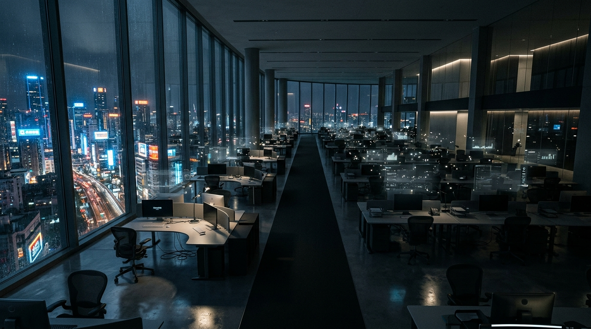

I DALIS · 2 SKYRIUS
<h2 class="chapter-title">Baltųjų apykaklių saulėlydis ir „1 žmogaus vienaragiai“</h2>

  Du šimtmečius ekonomikos vadovėliai mokė vienos neginčijamos tiesos: mašinos pakeičia raumenis, o žmogaus protas, kūrybiškumas ir strateginis mąstymas yra neįveikiama tvirtovė. Tačiau istorija iškrėtė žiauriausią įmanomą pokštą – skaitmeninė revoliucija prasidėjo ne nuo šluotų ar kastuvų, o nuo teisininkų, finansininkų ir programuotojų kabinetų.

  Jei prieš dešimtmetį būtumėte paklausę bet kurio futuristo ar universiteto profesoriaus, kurie darbai bus automatizuoti pirmiausia, atsakymas būtų buvęs vieningas: sunkvežimių vairuotojai, sandėlininkai, valytojai ir statybininkai. „Mokykitės programuoti, eikite į teisę, tapkite rinkodaros strategais“, – kartojo karjeros konsultantai.

  Realybė pasirodė esanti diametraliai priešinga. Fiziniame pasaulyje pajudinti daiktą reikalauja milžiniškų energijos sąnaudų, brangios mechanikos, jutiklių ir atsparumo atšiaurioms oro sąlygoms. Tuo tarpu skaitmeniniame pasaulyje – kur gyvena teisinės sutartys, finansiniai modeliai, kodo eilutės ir rinkodaros kampanijos – duomenų judėjimas kainuoja artima nuliui.

<figure style="margin: 40px 0; border-radius: 14px; overflow: hidden; border: 1px solid var(--border-subtle);">
  
  <figcaption style="padding: 12px 18px; font-family: var(--font-sans); font-size: 0.85rem; color: var(--text-muted); background: var(--bg-surface); text-align: center; border-top: 1px solid var(--border-subtle);">
    Ištuštėję dangoraižiai: kai milijonus analitikų, teisininkų ir vadybininkų pakeičia nematomi debesų agentų spiečiai.
  </figcaption>
</figure>

<h3>Mustafa Suleymanas ir autonominių agentų banga</h3>

  Vienas įtakingiausių šiuolaikinio DI architektų, buvęs „DeepMind“ bendraįkūrėjas ir „Microsoft AI“ generalinis direktorius <strong>Mustafa Suleymanas</strong> laidoje <em>The Diary Of A CEO</em> išdėstė, kaip atrodys artimiausia ekonominė griūtis:

<blockquote class="expert-quote">
  „Mes pereiname nuo sistemų, kurios atsakinėja į klausimus, prie sistemų, kurios vykdo veiksmus. Autonominis agentas – tai nebe pokalbių robotas. Tai skaitmeninis darbuotojas, kuriam pasakote: 'Štai mano biudžetas, surask tiekėjus, suderėk 15% geresnę kainą, pasirašyk sutartis ir paleisk produktą į rinką'. Ir jis tai padaro per kelias valandas. Tai iš esmės panaikina visą vidurinįjį korporacijų valdymo sluoksnį.“
  <cite>— Mustafa Suleyman, knygos „The Coming Wave“ autorius, The Diary Of A CEO</cite>
</blockquote>

  Suleymanas perspėja apie fundamentalų reiškinį, kurį jis vadina <strong>„Asimetrinio pajėgumo sprogimu“</strong>: maža žmonių grupė arba net pavienis asmuo dabar gali valdyti resursus, kurie anksčiau reikalavo šimtų darbuotojų komandos.

<h3>„1 žmogaus milijardinė kompanija“</h3>

  „OpenAI“ vadovas Samas Altmanas kartu su buvusiu „Stability AI“ įkūrėju <strong>Emadu Mostaque</strong> prognozuoja, kad iki 2027–2028 m. mes išvysime pirmąją pasaulyje multimilijardinės vertės kompaniją, kurioje dirbs <strong>tik vienas žmogus</strong>.

  Kaip atrodo ši struktūra?

<ul style="padding-left: 28px; margin-bottom: 24px; color: var(--text-secondary);">
  <li style="margin-bottom: 10px;"><strong>Vienas žmogus (Savininkas / Dirigentas):</strong> Teikia viziją, moralines gaires ir galutinį patvirtinimą.</li>
  <li style="margin-bottom: 10px;"><strong>50 specializuotų agentų:</strong> Programuoja, testuoja, valdo serverius, vykdo buhalteriją, atlieka teisinį auditą, kuria 4K vaizdo reklamą, veda derybas 40 kalbų realiuoju laiku.</li>
  <li style="margin-bottom: 10px;"><strong>Nulinė administracinė trintis:</strong> Nėra sergančių darbuotojų, nėra vidinių intrigų, nėra vėluojančių ataskaitų, jokių brangių biurų nuomos kaštų.</li>
</ul>

<h3>Autonomijos piramidė: Nuo paprasto asistento iki „Savavaldės Korporacijos“ (L0–L5)</h3>

  Kaip automobilių pramonėje skiriami autonominio vairavimo lygiai (nuo pastovaus greičio palaikymo iki automobilio be vairo), taip ir versle bei profesijose vyksta griežta autonomijos evoliucija:

  <h4>6 Verslo ir Darbo Autonomijos Lygiai:</h4>
  

    • <strong>L0 (Rankinis darbas):</strong> Žmogus viską daro pats (2010 m. pasaulis). 
    • <strong>L1 (Asistentas):</strong> Žmogus rašo promptą, DI sugeneruoja tekstą ar formulę („Copilot“, ankstyvasis ChatGPT). Žmogus yra 95% atsakomybės grandinės butelio kaklelis. 
    • <strong>L2 (Dalinė autonomija):</strong> Agentai atlieka vienos krypties užduotis (pvz., automatinis atsakymas į klientų užklausas el. paštu pagal taisykles). 
    • <strong>L3 (Sąlyginė autonomija):</strong> Agentas pats atlieka tyrimą, parašo ataskaitą ir paruošia sutartį. Žmogus tik uždeda parašą arba sprendžia išimtines krizes. 
    • <strong>L4 (Aukštoji autonomija – 2026–2028 m.):</strong> <em>Uždaro ciklo agentų spiečius</em>. Įmonė veikia visiškai savarankiškai: pritraukia klientus balsu, išrašo sąskaitas, vykdo buhalteriją, atlieka teisinį auditą ir perprogramuoja savo svetainę. Žmogus-savininkas kartą per savaitę patikrina pelno ataskaitą telefone. 
    • <strong>L5 (Visuotinė autonomija – 2030+ m.):</strong> <em>Self-Driving Enterprise</em>. Įmonės pačios kuria kitas įmones, samdo kitus agentus, perka skaičiavimo resursus debesyje ir investuoja pelną be jokio žmogiškojo savininko dalyvavimo.
  

<h3>Visų profesijų likimo atlasas: Kas krenta pirmas, o kas išlieka?</h3>

  <table class="book-table">
    <thead>
      <tr>
        <th>Profesinė sritis</th>
        <th>Kas atsitinka iki 2028 m.?</th>
        <th>Autonomijos lygis (2030 m.)</th>
        <th>Rizikos lygis</th>
      </tr>
    </thead>
    <tbody>
      <tr>
        <td><strong>Programavimas ir IT</strong></td>
        <td>Junior kodo rašymas miršta; agentai patys kuria ir testuoja sistemas. REA atveria bet kurį uždarą kodą.</td>
        <td>L4–L5 (Savaime besitaisantis kodas)</td>
        <td style="color: var(--accent-crimson); font-weight: 700;">KRITINIS (92%)</td>
      </tr>
      <tr>
        <td><strong>Teisė ir Notariatas</strong></td>
        <td>Sutarčių auditas ir precedentų paieška trunka 5 sekundes. Išmanieji kontraktai pakeičia notarus.</td>
        <td>L4 (Autonominiai arbitrai)</td>
        <td style="color: var(--accent-crimson); font-weight: 700;">KRITINIS (89%)</td>
      </tr>
      <tr>
        <td><strong>Apskaita, Finansai ir Auditas</strong></td>
        <td>Atviroji bankininkystė sujungta su DI: kvitų suvedimas ir ataskaitos suderinamos realiuoju laiku.</td>
        <td>L5 (Nulinė buhalterinė trintis)</td>
        <td style="color: var(--accent-crimson); font-weight: 700;">MAKSIMALUS (96%)</td>
      </tr>
      <tr>
        <td><strong>Medicina (Diagnostika ir Radiologija)</strong></td>
        <td>DI skaito MRT ir rentgeno nuotraukas tiksliau už profesorių konsiliumą. Klinikinės simuliacijos pakeičia bandymus.</td>
        <td>L4 (Skaitmeninis gydytojas)</td>
        <td style="color: var(--accent-crimson); font-weight: 700;">AUKŠTAS (85%)</td>
      </tr>
      <tr>
        <td><strong>Švietimas ir Universitetai</strong></td>
        <td>Paskaitų skaitymas miršta. Kiekvienas studentas turi asmeninį sokratišką mentorių; 4 metų diplomai praranda vertę.</td>
        <td>L4 (Individualizuotas DI mokymas)</td>
        <td style="color: var(--accent-amber); font-weight: 700;">AUKŠTAS (80%)</td>
      </tr>
      <tr>
        <td><strong>Kūrybinės Industrijos (Kinas, Menas, Muzika)</strong></td>
        <td>Vienas asmuo sugeneruoja pilnametražį 4K filmą su garso takeliu ir aktorių balsais per savaitę.</td>
        <td>L4 (Sintezuotas autorinis kinas)</td>
        <td style="color: var(--accent-crimson); font-weight: 700;">KRITINIS (87%)</td>
      </tr>
      <tr>
        <td><strong>Viešasis Sektorius ir Valstybės Tarnyba</strong></td>
        <td>Pažymų, leidimų ir registrų klerkai eliminuojami. Valstybės paslaugos teikiamos akimirksniu per API.</td>
        <td>L4–L5 (Autonominė e-valdžia)</td>
        <td style="color: var(--accent-crimson); font-weight: 700;">KRITINIS (90%)</td>
      </tr>
      <tr>
        <td><strong>Transportas ir Logistika</strong></td>
        <td>Autonominės sunkvežimių vilkstinės greitkeliuose, dronai miestuose, robotizuoti sandėliai aklinoje tamsoje.</td>
        <td>L5 (Pilnavertis autonominis transportas)</td>
        <td style="color: var(--accent-crimson); font-weight: 700;">MAKSIMALUS (95%)</td>
      </tr>
      <tr>
        <td><strong>Statyba ir Fizinis Darbas</strong></td>
        <td>3D betono spausdinimas; humanoidai perima stogdengystę ir apdailą. Santechnikai saugūs iki ~2032 m.</td>
        <td>L3–L4 (Robotizuota statyba)</td>
        <td style="color: var(--accent-amber); font-weight: 700;">VIDUTINIS / AUKŠTAS (70%)</td>
      </tr>
      <tr>
        <td><strong>Psichoterapija ir Dvasinis Palydėjimas</strong></td>
        <td>Didžiulė paklausa gyvam, jaučiančiam žmogui. Žmogiškasis ryšys tampa prabangiausia statuso preke.</td>
        <td>L1–L2 (Žmogus išlieka centre)</td>
        <td style="color: var(--accent-emerald); font-weight: 700;">ŽEMAS (25%)</td>
      </tr>
    </tbody>
  </table>

<h3>Kūrybinės industrijos agonija: 3D menininkai, žaidimų studijos ir Holivudas</h3>

  Ilgus dešimtmečius kūrybinis elitas guodėsi viena mintimi: <em>„Mašinos gali atlikti buhalteriją ar programuoti, bet jos niekada neturės meninės sielos, stiliaus jausmo ir estetinio skonio“</em>. Tai buvo pats naiviausias mitas. Būtent kūrybinis sektorius tapo pirmąja pramonės šaka, kurioje įvyko totalinė kadrų skerdynė.

  <h4>3D menininko tragedija: 7 metai mokslo prieš 15 sekundžių algoritmą</h4>
  

    Įsivaizduokite talentingą jaunuolį, kuris septynerius metus praleido prie kompiuterio ekrano. Jis išmoko sudėtingiausių programų: „Blender“, „Maya“, „ZBrush“, „Substance Painter“. Jis mokėsi anatomijos, šviesos lūžio, poligonų tinklelio optimizavimo (angl. <em>retopology</em>), kaulų karkaso kūrimo (angl. <em>rigging</em>) ir tekstūrų piešimo. Dar 2022 metais tokiam specialistui sukurti vieną detalų video žaidimo personažą ar filmo drakoną užtrukdavo <strong>dvi ar tris savaites sunkaus darbo</strong>, o studijos mokėjo solidžius atlyginimus.
      
    Šiandien atsirado tokios sistemos kaip „Rodin Gen-2“, „Tripo“ ir erdviojo intelekto modeliai iš „World Labs“. Moksleivis įrašo vieną sakinį: <em>„Sukurk gotikinio stiliaus kiborgą-karį su surūdijusiais šarvais ir paruoštu judėti karkasu“</em>.
      
    Po <strong>15 sekundžių</strong> sistema pateikia tobulą, tekstūruotą, pilnai paruoštą animacijai 3D modelį. Tai, kam reikėjo dviejų savaičių triūso, dabar įvyksta per laiką, kol žmogus gurkšteli arbatos. Žaidimų studijos, kuriose dirbo 80 3D modeliuotojų, šiandien palieka du darbuotojus, kurių vienintelis darbas – generuoti ir atrinkti geriausius variantus.
  

  Pažvelkite į tai, kas 2024–2026 m. nutiko globaliai vaizdo žaidimų pramonei. Tokie milžinai kaip „Sony“, „Ubisoft“, „Electronic Arts“, „Riot Games“ ir „Microsoft“ atleido <strong>dešimtis tūkstančių darbuotojų</strong>. Tai nebuvo laikina finansinė krizė. Tai buvo struktūrinis lūžis: maža 4 asmenų nepriklausomų kūrėjų komanda, pasitelkusi DI agentus muzikai, 3D modeliams, dialogams ir kodui, šiandien gali sukurti produktą, kuriam anksčiau reikėjo 300 žmonių studijos ir 100 milijonų dolerių biudžeto.

  <h4>Holivudo pabaiga: Tylerio Perry 800 mln. dolerių pamoka</h4>
  

    2024 m. pradžioje garsus JAV kino magnatas, režisierius ir studijos savininkas <strong>Tyleris Perry</strong> ketino pradėti grandiozinę 800 milijonų dolerių vertės kino studijos plėtrą Atlantoje – statyti 12 naujų filmavimo paviljonų, grimo kambarius ir dekoracijų sandėlius.
      
    Tačiau tą pačią savaitę „OpenAI“ pristatė vaizdo generatorių „Sora“. Perry pamatė kadrus, kuriuose Viktorijos laikų Londono gatve lietuje važiuoja karieta, ant grindinio švyti žibintų atspindžiai, o fone matyti tobulai atkurta epochos architektūra. Nereikėjo nei kelionių į Londoną, nei dekoracijų statybos, nei apšvietėjų komandos, nei leidimų iš savivaldybės.
      
    Perry <strong>akimirksniu sustabdė 800 mln. dolerių projektą</strong> ir viešai perspėjo industriją: <em>„Tai paveiks visus – nuo aktorių ir operatorių iki apšvietėjų, vairuotojų ir maisto tiekėjų aikštelėje. Jei filmą gali sukurti sėdėdamas savo svetainėje, visa fizinė kino pramonė patiria mirtiną smūgį“</em>.
      
    Tą patį likimą patiria ir **balsų dubliavimo bei vertimo rinka**. Tokios sistemos kaip „ElevenLabs“ geba per sekundę nukopijuoti bet kurio aktoriaus balsą su visomis emocijomis, dūsavimais, ašaromis ir intonacijomis bei akimirksniu prašnekti 40 užsienio kalbų paties aktoriaus balsu. Ištisos filmų ir audioknygų įgarsinimo studijos Europoje užsidaro akyse.
  

<h3>Sulaužytų karjeros laiptų tragedija: Junior vakuumas</h3>

  Tačiau pati baisiausia šios transformacijos pasekmė slypi ne patyrusių ekspertų netektyse, o jaunimo ateityje. Istoriškai kiekviena profesija veikė kaip pameistrystės sistema: pradedantysis specialistas (angl. <em>junior</em>) atlikdavo nuobodų, rutinį darbą – pildė lenteles, tikrino smulkias klaidas kode, skaitė nuobodžias sutartis. Už tai jis gaudavo nedidelę algą, bet svarbiausia – mokėsi amato ir po 5–7 metų tapdavo patyrusiu profesionalu.

  Šiandien DI atlieka visą šį pradinį darbą <strong>nemokamai, akimirksniu ir be klaidų</strong>.

  <h4>Karta be pirmojo laiptelio</h4>
  

    Jei įmonėms nebereikia pradedančiųjų darbuotojų, kas nutinka su universitetais ir absolventais? Mes sukuriame situaciją, kuomet karjeros laiptai netenka pirmųjų keturių laiptelių. Reikalaujama tik aukščiausio lygio strategų, gebančių diriguoti DI, tačiau niekas nebežino, kaip jais tapti, jei niekada neturėjai galimybės klysti pradedančiojo pozicijoje. Tai fundamentali krizė, kurios pasekmes visuomenė pajus iki 2028 metų.
  

  Baltųjų apykaklių pasaulis skyla į šukes. Tačiau biurų ir profesijų automatizavimas tėra menkas vėjo gūsis prieš artėjančią audrą. Kas nutinka, kai šie tūkstančiai agentų susijungia į vieną visaapimantį, dieviško lygio protą – Bendrąjį Dirbtinį Intelektą (AGI), o netrukus ir Superintelektą (ASI)? Kaip mašinos rengiasi per kelis mėnesius išgydyti visas žinomas ligas ir kodėl šis proveržis sukels didžiausią egzistencinį sukrėtimą medicinos ir žmogaus istorijoje? Atsakymas – kitame skyriuje.

