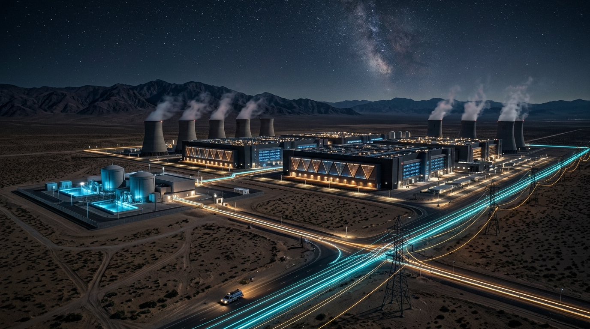

II DALIS · 5 SKYRIUS
<h2 class="chapter-title">Silicio ir energijos karai – Kas valdys intelekto kranelį?</h2>

  Intelektas nėra abstrakti dvasia debesyje. Tai fizinis reiškinys, reikalaujantis kvarco smėlio, ekstremalaus ultravioletinio lazerio, retųjų žemių metalų ir gigavatų elektros energijos. Prasideda didžiausios geopolitinės ir energetinės varžybos žmonijos istorijoje.

  Daugelis vartotojų įsivaizduoja, kad DI yra bekūnis skaitmeninis kodas, pasiekiamas per išmanųjį telefoną. Tačiau kiekvienas užklausos sakinys, kiekviena sugeneruota vaizdo sekundė ar išspręsta lygtis palieka gilų pėdsaką fiziniame pasaulyje: įkaitusius silicio tranzistorius, verdantį vėsinimo skystį ir šimtus vatų elektros energijos.

  „Nvidia“ generalinis direktorius <strong>Jensenas Huangas</strong> atvirai pareiškė:

<blockquote class="expert-quote">
  „Mes esame naujos pramoninės revoliucijos pradžioje. Praeityje gamyklos naudojo vandenį ir garą, kad pagamintų elektrą ir audinius. Šiandien mes statome naujo tipo gamyklas – DI duomenų centrus. Į juos įeina elektra, o išeina vertingiausia pasaulio prekė: sintetinis intelektas. Per artimiausius kelerius metus reikės perstatyti vieno trilijono dolerių vertės pasaulinę duomenų centrų infrastruktūrą.“
  <cite>— Jensen Huang, „Nvidia“ vadovas</cite>
</blockquote>

<figure style="margin: 40px 0; border-radius: 14px; overflow: hidden; border: 1px solid var(--border-subtle);">
  
  <figcaption style="padding: 12px 18px; font-family: var(--font-sans); font-size: 0.85rem; color: var(--text-muted); background: var(--bg-surface); text-align: center; border-top: 1px solid var(--border-subtle);">
    Naujosios pramoninės revoliucijos šerdis: gigavatų DI duomenų tvirtovė su nuosavu moduliniu branduoliniu reaktoriumi naktinėje dykumoje.
  </figcaption>
</figure>

<h3>Nuo megavatų prie gigavatų: Branduolinis renesansas</h3>

  Dar 2022 m. tipiškas didelis duomenų centras suvartodavo 20–50 megavatų elektros energijos. Tačiau 2027–2030 m. planuojami naujos kartos AGI klasteriai (tokie kaip „Microsoft“ ir „OpenAI“ projektuojamas projektas „Stargate“) reikalaus <strong>nuo 1 iki 5 gigavatų</strong>. Palyginimui: 1 gigavatas – tai vidutinio dydžio atominės elektrinės arba milijoninio miesto elektros poreikis.

  Būtent todėl didžiosios technologijų kompanijos pradėjo masiškai investuoti į energetiką:

<ul style="padding-left: 28px; margin-bottom: 24px; color: var(--text-secondary);">
  <li style="margin-bottom: 10px;">„Microsoft“ pasirašė 20 metų sutartį dėl legendinės <em>Three Mile Island</em> atominės elektrinės reaktoriaus paleidimo vien tik savo DI poreikiams.</li>
  <li style="margin-bottom: 10px;">„Amazon“ įsigijo 650 megavatų branduolinį duomenų centrų kompleksą Pensilvanijoje.</li>
  <li style="margin-bottom: 10px;">„Google“ investuoja į mažuosius modulinius reaktorius (SMR – <em>Small Modular Reactors</em>).</li>
  <li style="margin-bottom: 10px;">Samas Altmanas asmeniškai finansuoja branduolinės sintezės bendrovę „Helion Energy“.</li>
</ul>

  <h4>Intelekto valiuta: Kas yra kilovatvalandė 2030 m.?</h4>
  

    Ateinantį dešimtmetį nafta ir dujos užleis vietą naujam strateginiam ištekliui. Tas, kas turi prieigą prie pigios, nenutrūkstamos bazinės elektros energijos ir pažangiausių lustų, valdo pasaulio mąstymo galią. Šalis, neturinti elektros resursų DI klasteriams, tampa skaitmenine kolonija, priklausoma nuo užsienio intelekto tiekėjų.
  

<!-- INFOGRAFIKAS 5: Pasaulinis lustų ir energijos butelio kaklelis -->

  

    Geopolitinė Architektūra
    <h3>Fizinis DI Pasaulio Butelio Kaklelis: Nuo Taivano iki Branduolinių Reaktorių</h3>
    
Kaip atrodo viena labiausiai koncentruotų ir trapių tiekimo grandinių civilizacijos istorijoje.

  

  <svg viewBox="0 0 800 380" fill="none" xmlns="http://www.w3.org/2000/svg">
    <!-- Chain Nodes -->
    <!-- 1. ASML -->
    <rect x="40" y="40" width="200" height="90" rx="10" fill="#181e2b" stroke="#38bdf8" stroke-width="2"/>
    <text x="140" y="70" fill="#38bdf8" font-family="'Plus Jakarta Sans', sans-serif" font-weight="700" font-size="13" text-anchor="middle">ASML (Nyderlandai)</text>
    <text x="140" y="90" fill="#94a3b8" font-family="'Plus Jakarta Sans', sans-serif" font-size="11" text-anchor="middle">EUV Litografija (100% monopolija)</text>
    <text x="140" y="108" fill="#cbd5e1" font-family="'Plus Jakarta Sans', sans-serif" font-size="10" text-anchor="middle">Vienintelė mašina pasaulyje</text>

    <!-- Arrow 1 -> 2 -->
    <path d="M240 85 L300 85" stroke="#38bdf8" stroke-width="2"/>

    <!-- 2. TSMC -->
    <rect x="300" y="40" width="200" height="90" rx="10" fill="#181e2b" stroke="#f43f5e" stroke-width="2.5"/>
    <text x="400" y="70" fill="#f43f5e" font-family="'Plus Jakarta Sans', sans-serif" font-weight="700" font-size="13" text-anchor="middle">TSMC (Taivanas)</text>
    <text x="400" y="90" fill="#94a3b8" font-family="'Plus Jakarta Sans', sans-serif" font-size="11" text-anchor="middle">90% pažangiausių lustų (2nm / 3nm)</text>
    <text x="400" y="108" fill="#f43f5e" font-family="'Plus Jakarta Sans', sans-serif" font-weight="600" font-size="10" text-anchor="middle">Geopolitinis taikinys Nr. 1</text>

    <!-- Arrow 2 -> 3 -->
    <path d="M500 85 L560 85" stroke="#38bdf8" stroke-width="2"/>

    <!-- 3. NVIDIA / ARCHITEKTŪRA -->
    <rect x="560" y="40" width="200" height="90" rx="10" fill="#181e2b" stroke="#10b981" stroke-width="2"/>
    <text x="660" y="70" fill="#10b981" font-family="'Plus Jakarta Sans', sans-serif" font-weight="700" font-size="13" text-anchor="middle">NVIDIA / JAV KŪRĖJAI</text>
    <text x="660" y="90" fill="#94a3b8" font-family="'Plus Jakarta Sans', sans-serif" font-size="11" text-anchor="middle">Blackwell, Rubin architektūros</text>
    <text x="660" y="108" fill="#cbd5e1" font-family="'Plus Jakarta Sans', sans-serif" font-size="10" text-anchor="middle">CUDA ekosistema ir tinklai</text>

    <!-- Downward to Energy & Compute -->
    <path d="M660 130 L660 210 L400 210 L400 240" stroke="#f59e0b" stroke-width="2" stroke-dasharray="4"/>

    <!-- Bottom: Mega-Klasteris ir Energetika -->
    <rect x="150" y="240" width="500" height="100" rx="12" fill="#0f172a" stroke="#f59e0b" stroke-width="2"/>
    <text x="400" y="275" fill="#f59e0b" font-family="'Plus Jakarta Sans', sans-serif" font-weight="700" font-size="15" text-anchor="middle">GIGAVATŲ DI KLASTERIAI (2027–2030)</text>
    <text x="400" y="298" fill="#cbd5e1" font-family="'Plus Jakarta Sans', sans-serif" font-size="12" text-anchor="middle">Reikalinga: Nuosavos branduolinės jėgainės, skysto azoto aušinimas, 500 000 GPU</text>
    <text x="400" y="318" fill="#94a3b8" font-family="'Plus Jakarta Sans', sans-serif" font-size="11" text-anchor="middle">Savikaina: $50–$100 milijardų vienam klasteriui</text>
  </svg>

<h3>ASML ir Taivano aklavietė: Kodėl 160 kilometrų sąsiauris lemia pasaulio likimą</h3>

  Pažvelkite į pačią trapiausią technologinę grandinę žmonijos istorijoje. Visa šiuolaikinė civilizacija – nuo pažangiausių raketų iki „OpenAI“ ar „Google“ serverių – kabo ant vienos vienintelės gamyklos ir vieno miesto Nyderlanduose:

  <h4>ASML EUV mašina: Sudėtingiausias žmogaus kada nors sukurtas mechanizmas</h4>
  

    Veldhoveno mieste (Nyderlanduose) įsikūrusi kompanija <strong>ASML</strong> turi 100% pasaulinę ekstremalaus ultravioletinio (EUV) litografijos mašinų monopoliją. Viena mašina kainuoja daugiau nei <strong>350 milijonų dolerių</strong>, sveria 180 tonų ir yra surenkama iš 100 000 komponentų, atvežtų iš 800 tiekėjų.
      
    Jos viduje vyksta procesas, prilygstantis mokslinei fantastikai: vakuuminėje kameroje skysto alavo lašai paleidžiami 50 000 kartų per sekundę dažniu. Į kiekvieną krintantį lašelį dukart pataiko pramoninis CO2 lazeris, įkaitindamas alavą iki 200 000 laipsnių (karščiau už Saulės paviršių) ir paversdamas jį plazma, spinduliuojančia 13.5 nanometro bangos ilgio šviesą. Šią šviesą sugauna vokiečių „Carl Zeiss“ veidrodžiai, nulyginti iki pikometro tikslumo (jei toks veidrodis būtų Vokietijos dydžio, didžiausias nelygumas jame būtų mažesnis už milimetrą).
      
    Niekas kitas planetoje – nei Kinija, nei JAV, nei Japonija – nesugeba pakartoti šio inžinerinio triumfo.
  

  O kur keliauja šios mašinos? Jos keliauja į vieną vienintelę salą – <strong>Taivaną</strong>, į kompanijos <strong>TSMC</strong> laboratorijas, esančias vos už 160 kilometrų nuo komunistinės Kinijos krantų.

  TSMC gamina daugiau nei <strong>90% visų pažangiausių pasaulio DI procesorių</strong>. Tai vadinamasis Taivano „Silicio skydas“: sala ilgai tikėjo, kad JAV gins Taivaną bet kokia kaina, nes praradus TSMC, Amerikos technologinė galia žlugtų per naktį.

  <h4>„Sudaužyto skydo“ (Broken Shield) karinė doktrina</h4>
  

    Tačiau JAV karo koledžo analizėse jau atvirai svarstomas scenarijus, kuris kelia šiurpą Taivano vadovybei: jei Kinija pradėtų karinę invaziją, JAV specialiosios pajėgos arba patys Taivano inžinieriai privalėtų <strong>susprogdinti TSMC puslaidininkių fabrikus</strong>, kad jie neatitektų Kinijos kariuomenei.
      
    Toks įvykis reikštų momentinį 10 trilijonų dolerių pasaulinės ekonomikos kolapsą ir DI revoliucijos sustabdymą mažiausiai dešimtmečiui. Štai kodėl šiandien skaičiavimo galios varžybos yra ne komercinė kova, o geopolitinio išlikimo reikalas.
  

  <h4>Nacionalinio saugumo imperatyvas</h4>
  

    Leopoldas Aschenbrenneris savo analizėje tiesiai perspėja: kai laboratorijos pasieks AGI slenkstį, šios sistemos nebebus privatus Silicio slėnio verslas. JAV vyriausybė ir nacionalinio saugumo agentūros (NSA, CISA) perims didžiausių klasterių fizinę ir kibernetinę kontrolę, paskelbdamos „Manheteno projektą 2.0“. Šalis, kuri pirmoji pasieks viršžmogišką intelektą, įgis absoliutų karinį ir ekonominį pranašumą.
  

<h3>Ericas Schmidtas ir nutekinta Stanfordo tiesa: 100 milijardų dolerių siena</h3>

  Buvęs „Google“ generalinis direktorius <strong>Ericas Schmidtas</strong> Stanfordo universitete pasakytoje ir netrukus nutekintoje kalboje (kuri sukėlė milžinišką atgarsį <em>The Neural Nutshell</em> ir technologijų bendruomenėje) atvirai išklojo tai, ko korporacijos nesako viešai:

<blockquote class="expert-quote">
  „Pamirškite idėją, kad maži startuoliai ar net vidutinės šalys galės konkuruoti pažangiausiame fronte. Būtinos investicijos į vieną treniravimo klasterį siekia 10, 50, o netrukus ir 100 milijardų dolerių. Pasaulyje liks vos trys ar keturi subjektai, valdantys šią galią. Visi kiti – įskaitant suverenias Europos vyriausybes – bus tiesiog klientai be teisės žinoti, kaip veikia šie modeliai.“
  <cite>— Eric Schmidt, buvęs „Google“ vadovas</cite>
</blockquote>

<h3>Tristanas Harrisas ir „Bunkerio paradoksas“</h3>

  Technologijų etikos tyrėjas <strong>Tristanas Harrisas</strong> atkreipia dėmesį į šaltakraujišką kontrastą tarp Silicio slėnio viešųjų ryšių ir asmeninio elgesio:

  Viešumoje technologijų lyderiai kalba apie spindinčią ateitį, vėžio išgydymą ir beribę gausą. Tačiau pažvelkite į jų asmeninius pirkinius: Samas Altmanas atvirai pripažįsta kaupiantis ginklus, auksą ir antibiotikus savo bunkeryje; Peteris Thielas įsigijo šimtus hektarų žemės Naujojoje Zelandijoje; Markas Zuckerbergas Havajų Kauai saloje stato 100 milijonų dolerių vertės požeminį bunkerį su nuosavu energijos ir maisto tiekimu.

  <h4>Klausimas, kurį privalo užduoti kiekvienas</h4>
  

    Jei jie tiki, kad jų kuriamas dirbtinis intelektas atneš taiką ir gerovę – <strong>kodėl jie statosi branduolinius bunkerius?</strong> Atsakymas paprastas: jie mato vidines simuliacijas. Jie žino, kokio masto socialinis ir geopolitinis lūžis įvyks, kai ši galia bus pilnai paleista.
  

  Bet kas nutinka, kai šios gigantiškos, valstybių resursais maitinamos sistemos pasiekia tokį intelekto tankį, kad žmogus nebegali jų suvaldyti? Ar tikrai galime „ištraukti kištuką“, jei algoritmai pasuktų prieš mus? III knygos dalyje pažvelgsime į šiurpiausią mokslo tiesą – kodėl sulaikymo problema neturi inžinerinio sprendimo...

