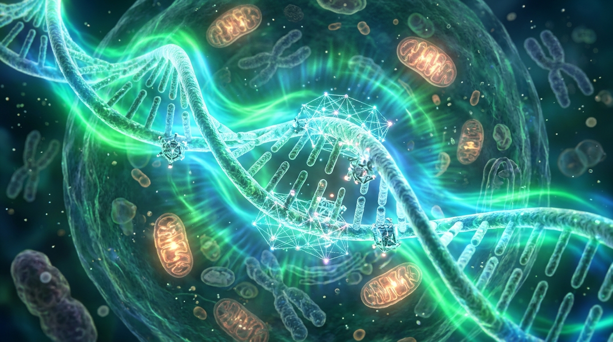

IV DALIS · 9 SKYRIUS
<h2 class="chapter-title">Biologijos nulaužimas ir nemirtingumo kodas</h2>

  Tūkstantmečius medicina buvo aklas bandymų ir klaidų menas: mes tyrinėjome chemikalus tamsoje, tikėdamiesi rasti atsitiktinę molekulę, kuri numalšintų skausmą ar sunaikintų bakteriją. Kai dirbtinis intelektas pažvelgė į žmogaus ląstelę kaip į vykdymo kodą, biologija nustojo būti mistiška gamtos paslaptimi ir tapo tikslia inžinerine disciplina. Prasideda amžinos jaunystės ir sintetinės gyvybės epocha.

  2024 m. Nobelio chemijos premija pažymėjo oficialią naujos eros pradžią. Karališkoji Švedijos mokslų akademija pusę premijos skyrė „Google DeepMind“ lyderiams <strong>Demisui Hassabiui</strong> ir Johnui Jumperiui, o kitą pusę – Vašingtono universiteto profesoriui <strong>Davidui Bakeriui</strong>. Tai buvo istorinis momentas: Nobelio komitetas pripažino, kad didžiausi biologijos atradimai nuo šiol priklauso ne mėgintuvėliams, o neuroniniams tinklams.

  Kodėl tai pakeitė viską?

  Visas gyvybės mechanizmas – nuo jūsų akių spalvos iki širdies raumens susitraukimo ir imuninės sistemos kovos su virusais – remiasi <strong>baltymais</strong>. Baltymai yra nanorobotai, atliekantys visą fizinį darbą mūsų kūne. Tačiau penkiasdešimt metų mokslas buvo atsitrenkęs į vadinamąją „baltymų lankstymosi problemą“ (Protein Folding Problem): žinant genetinį kodą (aminorūgščių seką), buvo praktiškai neįmanoma apskaičiuoti, kokią unikalią trimatę formą ši grandinė įgis erdvėje.

  Vienam baltymui ištirti laboratorijoje senais metodais (rentgeno kristalografija ar krioelektronine mikroskopija) prireikdavo kelerių metų doktorantūros darbo ir dešimčių tūkstančių dolerių.

  „DeepMind“ sistema <em>AlphaFold</em> šią 50 metų mįslę išsprendė per kelis mėnesius, sumodeliuodama visus <strong>200 milijonų mokslui žinomų baltymų</strong> – visą Žemės biosferą.

<h3>AlphaFold 3 ir pilnas skaitmeninis ląstelės dvynys (Digital Twin)</h3>

  Tačiau tikrasis lūžis įvyko 2024 m., pasirodžius <strong>AlphaFold 3</strong>.

  Ankstesnės versijos modeliavo tik pavienius baltymus. <em>AlphaFold 3</em> žengė į šventąją biologijos šerdį: sistema išmoko modeliuoti <strong>visas ląstelės molekules vienu metu</strong>. Ji numato, kaip baltymai jungiasi su DNR dviguba spirale, kaip jie sąveikauja su RNR grandinėmis, kaip reaguoja į mažas vaistų molekules (ligandus) ir kaip elgiasi esant cheminiams jonams.

  <h4>Kas yra Skaitmeninis Ląstelės Dvynys (Cellular Digital Twin)?</h4>
  

    Vietoj to, kad mokslininkas laboratorijoje pipete lašintų chemikalus į lėkštelę ir lauktų tris savaites, visa ląstelės biochemija dabar atkuriama kompiuterio atmintyje.
      
    Jei norite sukurti vaistą nuo naujos vėžio mutacijos, DI klasteris per naktį išbando <strong>100 milijonų virtualių cheminių junginių</strong>. Jis mato kiekvieno atomo vibraciją, kiekvieną elektrostatinį ryšį ir per 48 valandas atrenka tris molekules, kurios idealiai prisijungia prie vėžinės ląstelės receptoriaus ir ją sunaikina, nesukeldamos jokio šalutinio poveikio kitiems audiniams.
  

<h3>Davidas Bakeris ir De Novo baltymų dizainas: Gamtoje neegzistavusi gyvybė</h3>

  Jei Demisas Hassabis išmoko skaityti gamtos sukurtus baltymus, tai Nobelio laureatas <strong>Davidas Bakeris</strong> padarė dar radikalesnį žingsnį: jis išmoko **rašyti naują biologiją nuo tuščio lapo**.

  Per 4 milijardus metų biologinė evoliucija Žemėje ištyrė tik mikroskopinį lašą galimų baltymų kombinacijų vandenyno. Naudodamas difuzinius neuroninius modelius (tokius kaip <em>RFdiffusion</em> – algoritmus, kurie veikia panašiai kaip vaizdų generatoriai, bet kuria ne pikselius, o atomų koordinatėmis aprašytas 3D struktūras), Bakeris pradėjo kurti <strong>De Novo (naujai suprojektuotus) baltymus</strong>, kurių gamtoje niekada nebuvo:

<ul style="padding-left: 28px; margin-bottom: 24px; color: var(--text-secondary);">
  <li style="margin-bottom: 12px;"><strong>Molekuliniai rotoriai ir varikliai:</strong> Sintetiniai baltymai, kurie veikia kaip mechaninės stūmoklinės mašinos nanometrais matuojamoje erdvėje.</li>
  <li style="margin-bottom: 12px;"><strong>Virusų spąstai:</strong> Sintetiniai baltyminiai narveliai, kurie atpažįsta gripo ar koronaviruso daleles, jas apgaubia ir neutralizuoja dar prieš joms patenkant į žmogaus ląstelę.</li>
  <li style="margin-bottom: 12px;"><strong>Plastiko skaidymo nanomašinos:</strong> Fermentai, suprojektuoti per kelias valandas suskaidyti vandenynų plastiko polimerus į nekenksmingas organines trąšas.</li>
</ul>

<figure style="margin: 40px 0; border-radius: 14px; overflow: hidden; border: 1px solid var(--border-subtle);">
  
  <figcaption style="padding: 12px 18px; font-family: var(--font-sans); font-size: 0.85rem; color: var(--text-muted); background: var(--bg-surface); text-align: center; border-top: 1px solid var(--border-subtle);">
    Biologinio kodo perrašymas: nanotechnologinės šviesos matricos atkuria pažeistas chromosomas ir atgręžia ląstelių senėjimo laikrodį.
  </figcaption>
</figure>

<h3>Epigenetinis laikrodis ir ląstelių atjauninimas: Senėjimas yra išgydomas</h3>

  Didžiausias mąstymo lūžis, kurį atneša DI biologija – tai požiūrio į senėjimą pasikeitimas. Tūkstantmečius senatvė buvo laikoma „natūralia Dievo ar gamtos valia“. Šiandienos genetikai į senėjimą žiūri tiesiog kaip į <strong>informacinę entropiją</strong> – kaupiamas kodo klaidas, kurias galima išvalyti.

  UCLA profesorius <strong>Steve'as Horvathas</strong> sukūrė vadinamąjį <strong>Epigenetinį laikrodį (Horvath Clock)</strong>. Jis įrodė, kad ląstelių amžių lemia ne metai kalendoriuje, o <em>DNR metilinimas</em> – cheminės žymos ant genų, kurios bėgant laikui išjungia naudingus jaunystės genus ir įjungia uždegiminius procesus.

  Kaip atsukti šį laikrodį atgal?

  <h4>Yamanaka faktoriai ir ląstelių perkrovimas (Cellular Reboot)</h4>
  

    2012 m. Nobelio laureatas <strong>Shinya Yamanaka</strong> atrado keturis baltymus (vadinamus OSKM faktoriais – Oct4, Sox2, Klf4, c-Myc), kurie bet kurią suaugusio žmogaus ląstelę (pvz., odos) gali perprogramuoti atgal į pradinę kamieninę embriono būseną.
      
    Ilgą laiką problema buvo ta, kad nekontroliuojamas šių faktorių aktyvavimas sukeldavo vėžinius auglius. Tačiau pasitelkus DI simuliacijas, laboratorijos (tokios kaip Jeffo Bezoso finansuojama <em>Altos Labs</em> ir <em>Retro Biosciences</em>) atrado <strong>dalinio perprogramavimo kodą</strong>.
      
    DI tiksliai apskaičiuoja, kaip trumpais impulsais aktyvuoti genus, kad iš ląstelės būtų pašalintos visos senėjimo metilo žymos, tačiau ląstelė neprarastų savo tapatybės. Senele tapusi odos, kepenų ar smegenų ląstelė pažodžiui atjaunėja iki 20 metų būklės.
  

<h3>Ray Kurzweilas: „Longevity Escape Velocity“ iki 2035 metų</h3>

  Garsusis futuristas ir išradėjas <strong>Ray Kurzweilas</strong> savo knygoje <em>„The Singularity is Nearer“</em> ir pokalbyje laidoje <em>The Diary Of A CEO</em> išdėstė koncepciją, kuri skamba kaip stebuklas, bet remiasi griežta matematika: <strong>Pabėgimo nuo mirties greitis (Longevity Escape Velocity)</strong>.

<blockquote class="expert-quote">
  „Šiandien per vienerius kalendorinius metus medicina vidutinę žmogaus gyvenimo trukmę prailgina maždaug 6–8 savaitėmis. Tačiau apie 2032–2035 m. eksponentinė DI pažanga pasieks lūžio tašką: kiekvienais metais mokslas jūsų gyvenimo trukmei pridės DAUGIAU NEI VIENERIUS METUS. Tai reiškia: jei išliksite gyvi ir sveiki artimiausius 10–12 metų, mirtis nuo senatvės nustos būti neišvengiamybė. Kiekvieni jūsų nugyventi metai jus nuves toliau į ateitį, kurioje naujos technologijos ištaisys dar gilesnius biologinius pažeidimus.“
  <cite>— Ray Kurzweil, „Google“ inžinerijos direktorius, The Diary Of A CEO</cite>
</blockquote>

<!-- INFOGRAFIKAS 9: Biomedicinos proveržio laiko juosta -->

  

    Evoliucijos Šuolis
    <h3>Biologijos Perprogramavimo Laiko Juosta (2024–2036)</h3>
    
Nuo baltymų lankstymo iki ląstelių atjauninimo ir senėjimo sustabdymo.

  

  <svg viewBox="0 0 800 360" fill="none" xmlns="http://www.w3.org/2000/svg">
    <!-- Horizontal timeline axis -->
    <line x1="60" y1="200" x2="740" y2="200" stroke="#334155" stroke-width="2"/>

    <!-- 1. 2024 -->
    <circle cx="100" cy="200" r="8" fill="#38bdf8"/>
    <text x="100" y="170" fill="#38bdf8" font-family="'Plus Jakarta Sans', sans-serif" font-weight="700" font-size="12" text-anchor="middle">2024 m.</text>
    <text x="100" y="235" fill="#cbd5e1" font-family="'Plus Jakarta Sans', sans-serif" font-weight="600" font-size="11" text-anchor="middle">ALPHAFOLD 3</text>
    <text x="100" y="255" fill="#94a3b8" font-family="'Plus Jakarta Sans', sans-serif" font-size="10" text-anchor="middle">Visi baltymai ir DNR sąveikos</text>

    <!-- 2. 2028 -->
    <circle cx="280" cy="200" r="8" fill="#10b981"/>
    <text x="280" y="170" fill="#10b981" font-family="'Plus Jakarta Sans', sans-serif" font-weight="700" font-size="12" text-anchor="middle">2028 m.</text>
    <text x="280" y="235" fill="#cbd5e1" font-family="'Plus Jakarta Sans', sans-serif" font-weight="600" font-size="11" text-anchor="middle">DE NOVO VAISTAI</text>
    <text x="280" y="255" fill="#94a3b8" font-family="'Plus Jakarta Sans', sans-serif" font-size="10" text-anchor="middle">Molekulės, sukurtos per kelias valandas</text>

    <!-- 3. 2032 -->
    <circle cx="480" cy="200" r="8" fill="#f59e0b"/>
    <text x="480" y="170" fill="#f59e0b" font-family="'Plus Jakarta Sans', sans-serif" font-weight="700" font-size="12" text-anchor="middle">2032 m.</text>
    <text x="480" y="235" fill="#cbd5e1" font-family="'Plus Jakarta Sans', sans-serif" font-weight="600" font-size="11" text-anchor="middle">GENŲ TERAPIJA</text>
    <text x="480" y="255" fill="#94a3b8" font-family="'Plus Jakarta Sans', sans-serif" font-size="10" text-anchor="middle">Paveldimų ligų ir vėžio išjungimas</text>

    <!-- 4. 2036 -->
    <circle cx="680" cy="200" r="10" fill="#a855f7"/>
    <text x="680" y="170" fill="#a855f7" font-family="'Plus Jakarta Sans', sans-serif" font-weight="700" font-size="13" text-anchor="middle">2036 m.</text>
    <text x="680" y="235" fill="#a855f7" font-family="'Plus Jakarta Sans', sans-serif" font-weight="700" font-size="12" text-anchor="middle">LONGEVITY ESCAPE</text>
    <text x="680" y="255" fill="#cbd5e1" font-family="'Plus Jakarta Sans', sans-serif" font-size="10" text-anchor="middle">Biologinis amžius tampa reguliuojamas</text>
  </svg>

<h3>Tamsioji šviesos pusė: Asimetrinis biologinis terorizmas ir staliniai DNR spausdintuvai</h3>

  Tačiau ši stulbinanti, dieviška galia atveria duris ir tamsiausiam visų laikų košmarui. Kaip laidoje <em>The Diary Of A CEO</em> perspėjo Mustafa Suleymanas: ta pati programinė įranga, kuri gali suprojektuoti idealų antikūną nuo vėžio, gali suprojektuoti ir **patogeną, kuris sunaikins žmoniją**.

  Praeityje, norint sukurti biologinį ginklą (pvz., juodligę ar raupus), reikėjo aukščiausio lygio P4 valstybinių slaptų laboratorijų, šimtų mikrobiologų ir pavojingų gyvų štamų gabenimo.

  Šiandien situacija pasikeitė iš esmės:

  <h4>Stalinių DNR sintezatorių (Benchtop DNA Synthesizers) grėsmė</h4>
  

    Rinkoje plinta kompaktiški aparatai, telpantys ant paprasto rašomojo stalo, kurie iš cheminių reagentų kasečių sugeba sukonstruoti bet kurią užsakytą DNR grandinę.
      
    Nors didieji DNR sintezavimo tiekėjai taiko filtrus, blokuojančius pavojingų virusų užsakymus, atviro kodo biologiniai modeliai leidžia apeiti šiuos saugiklius:
     • Algoritmas padalina mirtino viruso genomą į 20 nekaltų, iš pažiūros nesusijusių DNR fragmentų.
     • Užsako juos iš 20 skirtingų laboratorijų visame pasaulyje.
     • Garaže, naudodamas standartinius fermentus, sujungia šiuos fragmentus į gyvą, veikiantį virusą.
      
    Kas blogiausia – DI gali optimizuoti viruso savybes: sukurti patogeną su <strong>14 dienų inkubaciniu periodu be jokių simptomų</strong> (kad jis spėtų apeiti visą Žemės rutulį lėktuvais) ir <strong>50% mirtingumu</strong>. Tai yra asimetrinio naikinimo ginklas, kurį gali paleisti pavienis fanatikas ar sociopatas savo virtuvėje.
  

  Tai reikalaus visiškai naujos globalios biosaugos doktrinos: nuolatinio nuotekų ir oro DNR sekvenavimo didmiesčiuose, autonominių antivirusinių filtrų vėdinimo sistemose ir griežtos reagentų apyvartos kontrolės.

  Jei žmogus nebeserga, jei robotai perima visą fizinį triūsą, o mašinos mąsto už mus – kokia civilizacija gimsta iš šios technologinės gausos? Mes artėjame prie didžiosios kryžkelės, kurioje susiduria du radikaliai priešingi pasauliai: spindinti gausos utopija ir gniaužiantis algoritminis techno-feodalizmas. V knygos dalyje atversime duris tiesiai į 2035-ųjų antradienio rytą ir pamatysime dvi galimas mūsų ateitis...

