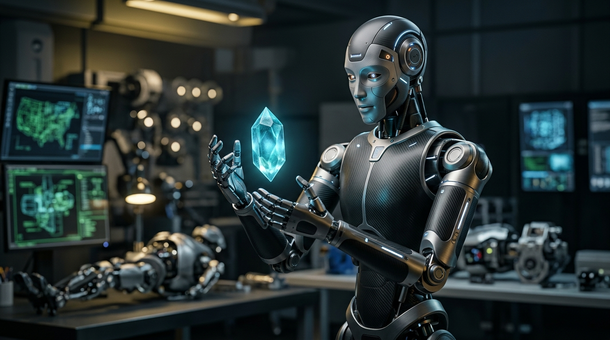

ЧАСТЬ IV · ГЛАВА 8
<h2 class="chapter-title">Волна гуманоидов — Конец физического труда</h2>

  Долгое время «синие воротнички» — сварщики, строители, складские рабочие, повара и сантехники — чувствовали себя в абсолютной безопасности: «Компьютер способен написать сонет или свести баланс, но он не заменит лопнувшую трубу, не сварит корпус судна и не положит кровлю». Это успокаивающее убеждение опиралось на парадокс Моравека. Однако когда большие языковые модели соединились с нейросетями пространственного зрения и физическими симуляциями, материальный мир капитулировал.

  В конце XX века пионер робототехники Ханс Моравек обратил внимание на поразительную эволюционную аномалию, получившую название <strong>парадокса Моравека</strong>: компьютерам удивительно легко дается то, что от человека требует максимального интеллектуального напряжения (играть в шахматы на гроссмейстерском уровне, решать дифференциальные уравнения, анализировать мировые финансовые рынки), но неимоверно трудно сделать то, с чем годовалый младенец справляется не задумываясь (узнать лицо матери, поднять сырое яйцо, не раздавив скорлупу, или перешагнуть через порог комнаты).

  Причина элементарна: на когнитивное мышление, речь и абстрактную логику эволюция человека отвела всего лишь несколько десятков тысяч лет, тогда как на зрение, моторику и пространственное равновесие природа потратила <strong>500 миллионов лет непрерывных проб и ошибок</strong>.

<figure style="margin: 40px 0; border-radius: 14px; overflow: hidden; border: 1px solid var(--border-subtle);">
  
  <figcaption style="padding: 12px 18px; font-family: var(--font-sans); font-size: 0.85rem; color: var(--text-muted); background: var(--bg-surface); text-align: center; border-top: 1px solid var(--border-subtle);">
    Завоевание физического мира: гуманоид из углеволокна и титана с тактильными сенсорами микронной точности, работающий 24/7 без усталости и ошибок.
  </figcaption>
</figure>

<h3>Великий прорыв: Sim2Real и VLA-модели</h3>

  Вплоть до 2024 года робототехника продвигалась черепашьими темпами, поскольку инженеры пытались запрограммировать каждое движение шарниров вручную либо обучали роботов в реальных физических лабораториях. Если робот учится брать стеклянный бокал в реальном мире, он разбивает его тысячи раз, требует бесконечного ремонта и постоянного надзора человека. Освоение одного-единственного жеста отнимало месяцы.

  Однако на рубеже 2024–2026 годов произошел тектонический сдвиг, соединивший в единый узел две технологические революции:

<ul style="padding-left: 28px; margin-bottom: 24px; color: var(--text-secondary);">
  <li style="margin-bottom: 12px;"><strong>Sim2Real («Из симуляции в реальность»):</strong> На таких платформах, как <em>NVIDIA Isaac Sim</em> и <em>Omniverse</em>, были развернуты фотореалистичные симуляторы физики, абсолютно точно воспроизводящие гравитацию, трение, оптические блики и сопротивление материалов. Вместо одного физического манипулятора на серверах запускаются <strong>100 000 виртуальных копий гуманоидов</strong>. За одну ночь они проживают <strong>10 000 лет концентрированного физического опыта</strong>: падают, поднимаются, взаимодействуют с десятками миллионов разнородных объектов. Утром эти обученные нейронные веса просто прошиваются в кремниевую память физического робота на заводском конвейере.</li>
  <li style="margin-bottom: 12px;"><strong>Vision-Language-Action (VLA) модели:</strong> Роботу больше не требуются заранее составленная карта помещения или жесткие скрипты. Он слышит живую речь человека: «Достань из того ящика ключ на двенадцать и затяни нижнюю левую гайку». Оптические сенсоры робота в реальном времени производят 3D-сегментацию окружения, а нейросеть напрямую преобразует слова в микромоторные импульсы кистей и пальцев.</li>
</ul>

<h3>Гонка пяти титанов: кто станет «Android» и «Apple» в мире робототехники?</h3>

  Глобальная битва за многотриллионный рынок физического труда уже развернулась в полную силу:

  <table class="book-table">
    <thead>
      <tr>
        <th>Платформа</th>
        <th>Компания / Партнеры</th>
        <th>Ключевое Преимущество</th>
        <th>Стадия Внедрения</th>
      </tr>
    </thead>
    <tbody>
      <tr>
        <td><strong>Optimus (Gen 2 / Gen 3)</strong></td>
        <td>Tesla (Илон Маск)</td>
        <td>Глубокая вертикальная интеграция: собственные аккумуляторы, приводы и колоссальный полигон автозаводов.</td>
        <td>Тысячные тиражи на фабриках Tesla (2025–2026).</td>
      </tr>
      <tr>
        <td><strong>Figure 02</strong></td>
        <td>Figure AI (OpenAI, Nvidia, Безос)</td>
        <td>Синтез речевого и логического интеллекта OpenAI со сборочными линиями автогиганта BMW.</td>
        <td>Коммерческие пилотные проекты в индустрии.</td>
      </tr>
      <tr>
        <td><strong>New Electric Atlas</strong></td>
        <td>Boston Dynamics (Hyundai)</td>
        <td>Невероятная свобода суставов на 360°, превосходящая анатомию человека; оптимизирован для тяжелых нагрузок.</td>
        <td>Логистика автомобильных компонентов.</td>
      </tr>
      <tr>
        <td><strong>Unitree G1</strong></td>
        <td>Unitree Robotics (Китай)</td>
        <td>Агрессивный ценовой демпинг: базовый гуманоид всего за <strong>16 000 долларов США</strong>.</td>
        <td>Массовое серийное производство и экспорт.</td>
      </tr>
      <tr>
        <td><strong>Neo</strong></td>
        <td>1X Technologies (Инвестиции OpenAI)</td>
        <td>Мягкая текстильная оболочка, созданная для полной безопасности рядом с детьми и в домашнем быту.</td>
        <td>Тестирование в роли домашних и офисных ассистентов.</td>
      </tr>
    </tbody>
  </table>

<h3>Экономическая точка перелома: рубеж 20 000 долларов</h3>

  Основатель компании Figure AI <strong>Бретт Эдкок</strong> в подкасте Стивена Бартлетта <em>The Diary Of A CEO</em> сформулировал фундаментальный экономический закон:

<blockquote class="expert-quote">
  «Люди не осознают, насколько стремительно рухнет себестоимость гуманоидов. Гуманоид состоит из алюминия, углеволокна, медных обмоток, литиевой батареи и набора камер. В нем нет ни грамма экзотических элементов. Когда тиражи достигнут сотен тысяч единиц в год, себестоимость робота упадет ниже 20 000 долларов. Сопоставьте это с живым работником, которому за десять лет выплачивается полмиллиона долларов с налогами и страховками. Математика настолько беспощадна, что ни одна частная или государственная структура не сможет отказаться от тотальной роботизации».
  <cite>— Бретт Эдкок, основатель Figure AI, The Diary Of A CEO</cite>
</blockquote>

<!-- INFOGRAFIKAS 8: Humanoido vs. Žmogaus darbuotojo kaštų ir produktyvumo kreivė -->

  

    Экономическая Гравитация · 2026–2035
    <h3>Точка Перелома в Физическом Труде: Зарплата Человека vs. Почасовая Стоимость Гуманоида</h3>
    
График показывает момент, когда эксплуатационные расходы на гуманоида падают ниже минимальной стоимости выживания человека.

  

  <svg viewBox="0 0 800 400" fill="none" xmlns="http://www.w3.org/2000/svg">
    <!-- Grid -->
    <line x1="80" y1="340" x2="740" y2="340" stroke="#334155" stroke-width="1.5"/>
    <line x1="80" y1="40" x2="80" y2="340" stroke="#334155" stroke-width="1.5"/>
    
    <line x1="80" y1="260" x2="740" y2="260" stroke="#1e293b" stroke-dasharray="4"/>
    <line x1="80" y1="180" x2="740" y2="180" stroke="#1e293b" stroke-dasharray="4"/>
    <line x1="80" y1="100" x2="740" y2="100" stroke="#1e293b" stroke-dasharray="4"/>

    <!-- Axis Labels -->
    <text x="80" y="365" fill="#64748b" font-family="'Plus Jakarta Sans', sans-serif" font-size="12">2026</text>
    <text x="240" y="365" fill="#64748b" font-family="'Plus Jakarta Sans', sans-serif" font-size="12">2028</text>
    <text x="410" y="365" fill="#f43f5e" font-family="'Plus Jakarta Sans', sans-serif" font-weight="700" font-size="12">2030 (ПЕРЕЛОМ)</text>
    <text x="580" y="365" fill="#64748b" font-family="'Plus Jakarta Sans', sans-serif" font-size="12">2033</text>
    <text x="720" y="365" fill="#10b981" font-family="'Plus Jakarta Sans', sans-serif" font-weight="700" font-size="12">2035</text>

    <!-- Human Labor Cost Curve (Steady/Rising with inflation) -->
    <path d="M80 180 L240 170 L410 160 L580 150 L740 140" stroke="#f43f5e" stroke-width="3" stroke-dasharray="5"/>
    <text x="740" y="130" fill="#f43f5e" font-family="'Plus Jakarta Sans', sans-serif" font-weight="600" font-size="11" text-anchor="end">Затраты на человеческий труд (~25–35 €/час)</text>

    <!-- Humanoid Cost Curve (Plummeting) -->
    <path d="M80 60 Q240 120 410 230 T740 315" stroke="#38bdf8" stroke-width="4" fill="none"/>
    <text x="740" y="305" fill="#38bdf8" font-family="'Plus Jakarta Sans', sans-serif" font-weight="700" font-size="12" text-anchor="end">Эксплуатация гуманоида (&lt; 2 €/час)</text>

    <!-- Tipping Point Intersection -->
    <circle cx="360" cy="165" r="8" fill="#f59e0b"/>
    <rect x="270" y="90" width="180" height="55" rx="8" fill="#181e2b" stroke="#f59e0b" stroke-width="1.5"/>
    <text x="360" y="112" fill="#ffffff" font-family="'Plus Jakarta Sans', sans-serif" font-weight="700" font-size="11" text-anchor="middle">ТОЧКА ПАРИТЕТА (2029 г.)</text>
    <text x="360" y="130" fill="#94a3b8" font-family="'Plus Jakarta Sans', sans-serif" font-size="10" text-anchor="middle">Робот окупается за 8 мес.</text>
  </svg>

<h3>«Иллюзия мастера» (The Tradesman Fallacy)</h3>

  Многие скептики до сих пор убаюкивают себя мыслью: «Пусть робот сортирует коробки на складах Amazon, но он никогда не приедет ко мне домой, не залезет под раковину и не распутает проржавевшую трубу пятидесятилетней давности».

  Этот аргумент называют <strong>иллюзией мастера</strong>. Он ошибочно исходит из предпосылки, что машина должна конструироваться под каждый конкретный дом индивидуально. В реальности роботу достаточно обладать кистью руки с 22 степенями свободы (DoF) и пьезоэлектрическими тактильными датчиками на кончике каждого пальца.

  Если робот обходится компании в два евро в час, сервисная фирма отправит двух гуманоидов: один держит направленный прожектор и камеру высокого разрешения, другой за доли секунды проводит ультразвуковое сканирование скрытых дефектов, лазером срезает поврежденный участок и сплавляет новую полимерную муфту — без малейшей человеческой погрешности. <strong>К 2033 году ручное ремесло перестанет быть тихой гаванью спасения.</strong>

  <h4>Фабрики «Lights-Out»: Человек как помеха</h4>
  

    Уже сегодня на передовых производственных площадках Китая и США претворяется в жизнь концепция <em>«Lights-Out Manufacturing» (производство с выключенным светом)</em>. В таком заводском цеху нет освещения, нет отопления, нет вентиляции, рассчитанной на дыхание легких, нет туалетов и комнат отдыха. Есть только абсолютная тьма, гул вентиляторов охлаждения и сотни гуманоидов, перемещающихся с микронной точностью. В подобной среде биологический человек превращается не в ценность, а в ходячий фактор риска для стерильности, безопасности и технологического ритма.
  

  Если роботы забирают на себя весь физический труд, а нейросети — всю интеллектуальную работу, что происходит с самим человеческим телом? Обречены ли мы стареть и угасать, или тот же искусственный интеллект вручит нам ключ к взлому биологического кода, искоренению болезней и клеточному бессмертию? В следующей главе мы приоткроем кулисы медицинской революции — от алгоритмов AlphaFold до той точки, где каждый прожитый год будет добавлять вашей жизни больше двенадцати месяцев...

