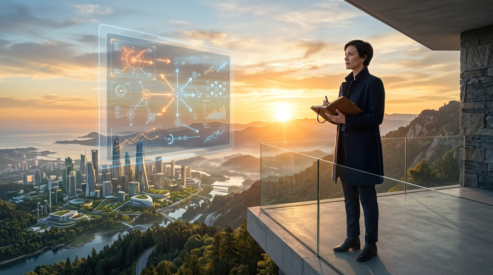

ЭПИЛОГ · ГЛАВА 16
<h2 class="chapter-title">Персональный кодекс выживания и процветания (2027–2037 гг.)</h2>

  Страх — худший советчик, а пассивное ожидание — гарантированный билет на обочину истории. Наступающее десятилетие окажется беспощадным к тем, кто тешит себя надеждой, что «всё как-нибудь образуется само собой». Однако для тех, кто постиг новые правила игры, распахиваются величайшие возможности за всю летопись человечества.

  Эта книга не должна и не будет заканчиваться парализующим пессимизмом или чувством обреченности. На протяжении тысячелетий человек успешно преодолевал ледниковые эпохи, эпидемии моровой язвы, тектонические сломы индустриальных революций и пожары мировых войн. Нашей несокрушимой видовой силой всегда оставалась способность вовремя проснуться, адаптироваться и возродиться на новом витке эволюции.

<figure style="margin: 40px 0; border-radius: 14px; overflow: hidden; border: 1px solid var(--border-subtle);">
  
  <figcaption style="padding: 12px 18px; font-family: var(--font-sans); font-size: 0.85rem; color: var(--text-muted); background: var(--bg-surface); text-align: center; border-top: 1px solid var(--border-subtle);">
    Триумф человеческого достоинства и суверенитета: технология — это бушующий океан, а человеческая мудрость, эмпатия и нравственный стержень — штурвал нашего корабля.
  </figcaption>
</figure>

  Вот четыре фундаментальные опоры, на которых мыслящий человек обязан перестроить свой быт, семейные стратегии и финансовые ориентиры на ближайшие десять лет:

  <h4>ОПОРА 1: Перераспределение активов и финансов (От зарплаты — к владению активами)</h4>
  

    <strong>Непреложное правило:</strong> Никогда больше не полагайтесь исключительно на наемную заработную плату за когнитивный или ручной труд. Ценовые колебания, инфляционные всплески и дефляционные шоки в отдельных секторах будут экстремальными.
      
    • <strong>Осязаемые материальные активы:</strong> Земля, собственный гарантированный источник чистой воды и автономной энергии (солнечная микрогенерация, домашние накопители). Чем меньше ваше базовое физическое выживание зависит от централизованных распределительных сетей, тем выше степень вашей подлинной свободы.
     
    • <strong>Интеллектуальный капитал инфраструктуры:</strong> Инвестируйте в структуры, контролирующие физическую основу вычислений (производители передовых полупроводников, поставщики энергогенерации, операторы опорных дата-центров), а не в традиционные посреднические сервисы.
  

  <h4>ОПОРА 2: Чему учить своих детей? (Перезагрузка образования)</h4>
  

    <strong>Непреложное правило:</strong> Перестаньте натаскивать детей на сдачу тестов по заучиванию фактов, типовому кодингу или механическому следованию шаблонам. Алгоритм выполняет это за 0,01 секунды без малейшей ошибки.
      
    • <strong>Контекстное мышление и оркестровка агентов:</strong> Способность увидеть системную проблему целиком, соединить этику с технологией и направить пятьдесят автономных ИИ-агентов на решение сложной междисциплинарной задачи.
     
    • <strong>Материальный мир и телесное мастерство:</strong> Живой контакт с природой, спорт, прикладные навыки выживания, мелкая моторика, механическое чутье. Человек, умеющий живо взаимодействовать с людьми и уверенно владеющий собственным телом, будет психологически на порядок устойчивее сверстника, запертого в цифровой капсуле.
     
    • <strong>Критический фильтр и иммунитет к манипуляциям:</strong> Навык мгновенно распознавать синтетический морок, дипфейки и алгоритмические ловушки внимания.
  

  <h4>ОПОРА 3: Трансформация карьеры в роль «Дирижера Агентов»</h4>
  

    <strong>Непреложное правило:</strong> Прекратите состязаться с искусственным интеллектом в скорости обработки данных, глубине памяти или объеме рутинного вывода. Это соревнование проиграно заранее.
      
    • Перестаньте быть просто «генератором ответов». Станьте <strong>«мастером глубоких вопросов»</strong> и окончательным судьей ценности.
     
    • Перестраивайте деятельность на модели, опирающиеся на <strong>отношения предельного межличностного доверия</strong>. В мире, наводненном синтетическими ботами и галлюцинирующими копиями, честный, открытый, порядочный живой человек превращается в самую редкую и востребованную ценность.
  

  <h4>ОПОРА 4: Психологический иммунитет и цифровая гигиена</h4>
  

    <strong>Непреложное правило:</strong> Оберегайте свою дофаминовую систему как величайшее достояние личности.
      
    • Алгоритмы рекомендаций с обратной связью выстроены так, чтобы подчинить себе ваше внимание без остатка. Бесконтрольное потребление синтетического видеоряда и персонализированных лент атрофирует способность к длительной концентрации и глубокому созерцанию.
     
    • Введите режим бескомпромиссного цифрового детокса: как минимум один день в неделю проводите вдали от дисплеев, на открытом воздухе, в искреннем живом общении с семьей и друзьями.
  

<!-- INFOGRAFIKAS 16: 10 metų pasiruošimo matrica -->

  

    План Действий
    <h3>Стратегическая Матрица Подготовки на 10 Лет (2027–2037 гг.)</h3>
    
Практические ориентиры для каждого этапа жизни в десятилетие великого цивилизационного сдвига.

  

  <svg viewBox="0 0 800 360" fill="none" xmlns="http://www.w3.org/2000/svg">
    <!-- 3 Phase Blocks -->
    <rect x="40" y="40" width="220" height="280" rx="12" fill="#0f172a" stroke="#38bdf8" stroke-width="2"/>
    <text x="150" y="75" fill="#38bdf8" font-family="'Plus Jakarta Sans', sans-serif" font-weight="700" font-size="14" text-anchor="middle">ФАЗА I: 2027–2029</text>
    <text x="150" y="95" fill="#94a3b8" font-family="'Plus Jakarta Sans', sans-serif" font-size="11" text-anchor="middle">Агентный перелом</text>
    <line x1="60" y1="110" x2="240" y2="110" stroke="#1e293b"/>
    <text x="55" y="145" fill="#cbd5e1" font-family="'Plus Jakarta Sans', sans-serif" font-size="11">• Освойте оркестровку агентов</text>
    <text x="55" y="180" fill="#cbd5e1" font-family="'Plus Jakarta Sans', sans-serif" font-size="11">• Автоматизируйте рутину</text>
    <text x="55" y="215" fill="#cbd5e1" font-family="'Plus Jakarta Sans', sans-serif" font-size="11">• Уйдите из уязвимых ниш</text>
    <text x="55" y="250" fill="#cbd5e1" font-family="'Plus Jakarta Sans', sans-serif" font-size="11">• Наращивайте твердые активы</text>

    <rect x="290" y="40" width="220" height="280" rx="12" fill="#0f172a" stroke="#10b981" stroke-width="2"/>
    <text x="400" y="75" fill="#10b981" font-family="'Plus Jakarta Sans', sans-serif" font-weight="700" font-size="14" text-anchor="middle">ФАЗА II: 2030–2033</text>
    <text x="400" y="95" fill="#94a3b8" font-family="'Plus Jakarta Sans', sans-serif" font-size="11" text-anchor="middle">Робототехника и AGI</text>
    <line x1="310" y1="110" x2="490" y2="110" stroke="#1e293b"/>
    <text x="305" y="145" fill="#cbd5e1" font-family="'Plus Jakarta Sans', sans-serif" font-size="11">• Укрепите энергоавтономию</text>
    <text x="305" y="180" fill="#cbd5e1" font-family="'Plus Jakarta Sans', sans-serif" font-size="11">• Диверсифицируйте капитал</text>
    <text x="305" y="215" fill="#cbd5e1" font-family="'Plus Jakarta Sans', sans-serif" font-size="11">• Развивайте живые связи</text>
    <text x="305" y="250" fill="#cbd5e1" font-family="'Plus Jakarta Sans', sans-serif" font-size="11">• Мониторьте биосигналы</text>

    <rect x="540" y="40" width="220" height="280" rx="12" fill="#0f172a" stroke="#a855f7" stroke-width="2"/>
    <text x="650" y="75" fill="#a855f7" font-family="'Plus Jakarta Sans', sans-serif" font-weight="700" font-size="14" text-anchor="middle">ФАЗА III: 2034–2037</text>
    <text x="650" y="95" fill="#94a3b8" font-family="'Plus Jakarta Sans', sans-serif" font-size="11" text-anchor="middle">Пост-трудовой мир</text>
    <line x1="560" y1="110" x2="740" y2="110" stroke="#1e293b"/>
    <text x="555" y="145" fill="#cbd5e1" font-family="'Plus Jakarta Sans', sans-serif" font-size="11">• Жизнь вне рамок найма</text>
    <text x="555" y="180" fill="#cbd5e1" font-family="'Plus Jakarta Sans', sans-serif" font-size="11">• Долголетие и регенерация</text>
    <text x="555" y="215" fill="#cbd5e1" font-family="'Plus Jakarta Sans', sans-serif" font-size="11">• Общность и высший смысл</text>
    <text x="555" y="250" fill="#cbd5e1" font-family="'Plus Jakarta Sans', sans-serif" font-size="11">• Человек как свидетель бытия</text>
  </svg>

  «Будущее не высечено в граните. Это безбрежный океан, в который мы выходим все вместе. Те, кто постиг природу надвигающейся волны, оседлают ее гребень. Те, кто закрывает на нее глаза, будут сметены на дно. Выбор принадлежит вам».

