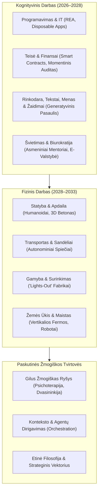
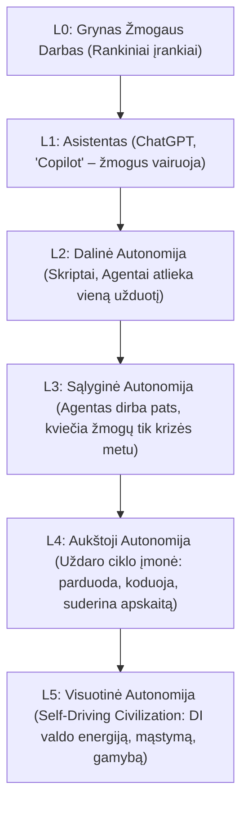

# SUPERMAX MASTER PLANAS IR ARCHITEKTŪRA
# „PO DARBO: Kaip AI iki 2037 m. perkurs ekonomiką, valstybes ir žmogų“

**Leidinio tipas:** Elitinė analitinė-strateginė monografija (PDF ir interaktyvi e-knyga)  
**Tikslas:** Galutinai numesti rožinius akinius visuomenei, parodyti, kodėl kreivė jau pasiekė beveik 90 laipsnių kampą, ir išsamiai išanalizuoti, kaip AGI bei Superintelektas (ASI) transformuos **kiekvieną profesiją, kiekvieną pramonės šaką ir visą žmogiškąją būtį**.

---

## 🧭 I. FILOSOFIJA IR PAMATINĖ AŠIS
1. **Ne mada, o evoliucinis rūšies lūžis:** Tai nėra „dar viena technologinė banga“. Tai akimirka, kuomet žmogus nustoja būti vieninteliu ir protingiausiu mąstančiu subjektu planetoje.
2. **Eksponento 90 laipsnių siena:** Pokyčiai nebevyksta dešimtmečiais. Viskas, kas anksčiau trukdavo 50 metų, dabar suspaudžiama į 12–18 mėnesių.
3. **Visapusiškas aprėpimas:** Nė viena profesija, nė vienas socialinis sluoksnis neliks nepaliestas.

---

## 📊 II. VISŲ PROFESIJŲ LIKIMO ATLASAS (2027–2037 M.)

### 1. Medicina, Farmacija ir Sveikatos Apsauga
* **Gydytojai diagnostikai ir radiologai:** Pakeičiami pirmiausia. Skaitmeninė rega ir multimodalus DI analizuoja tūkstančius tomografijų per sekundę su 99.9% tikslumu.
* **Chirurgai:** Preciziniai mikrorobotiniai manipuliatoriai (jokių drebančių rankų, submilimetrinis tikslumas) operuoja autonomiškai.
* **Farmacininkai:** Vaistinių darbuotojai nereikalingi; vaistai spausdinami vietoje pagal asmeninį DNR kodą.
* **Slaugytojai ir priežiūra:** Paskutinė saugi zona dėl gyvo prisilietimo ir empatijos poreikio, tačiau buitinę naštą perima minkštieji robotai (*1X Neo*).

### 2. Teisė, Teismų Sistema ir Notariatas
* **Junior teisininkai ir tyrėjai:** Išnyksta 100%. Bylų precedentų ir sutarčių analizė atliekama per 5 sekundes.
* **Notarai:** Pakeičiami kriptografiniais parašais ir išmaniaisiais kontraktais.
* **Teisėjai:** Pirmosios instancijos administracinės bylos sprendžiamos autonominių arbitrų be korupcijos ir subjektyvumo.

### 3. Finansai, Apskaita ir Draudimas
* **Buhalteriai ir auditoriai:** Maksimali rizika (99%). Atviroji bankininkystė, realaus laiko mokesčių suderinimas eliminuoja kvitų suvedimą.
* **Investiciniai analitikai ir treideriai:** Žmogus Volstrite jau dabar yra lėtas trikdis; rinkas valdo milisekundžių algoritmai.

### 4. Švietimas ir Universitetai
* **Tradiciniai dėstytojai:** Paskaitų skaitymas miršta. Kiekvienas studentas gauna asmeninį sokratišką mentorių, kuris žino vaiko kognityvinį tempą ir kalba jo mėgstamo herojaus balsu.
* **Universitetų krizė:** 4 metų bakalauro diplomas tampa bevertis, nes technologijos pasikeičia 3 kartus per studijų laikotarpį.

### 5. Programavimas, IT ir Kibernetinis Saugumas
* **Junior ir Mid programuotojai:** Rinka traukiasi 80%. REA (*Reverse Engineer Anything*) ir *Disposable Software* paverčia kodo rašymą nemokamu.
* **Kibernetinis saugumas:** Žmogus nebegali apginti tinklo; vyksta mašinų karai – autonominiai puolimo agentai prieš autonominius gynybos skydus.

### 6. Menas, Žaidimai ir Kūrybinės Industrijos
* **Dizaineriai ir iliustruotojai:** Adobe monopolių pabaiga. Kiekvienas gali generuoti 8K vaizdus ir video.
* **Vaizdo žaidimų industrija:** Unreal ir Unity variklių saulėlydis. *Decart Oasis*, *Google Genie* ir *Neural GTA 6* – žaidimai generuojami realiuoju laiku pagal žaidėjo vaizduotę.

### 7. Statyba, Apdaila ir Amatininkystė
* **Mūrininkai, betonuotojai:** 3D statybiniai spausdintuvai ir sunkieji robotai.
* **Apdailininkai, dažytojai, stogdengiai:** Humanoidai (*Boston Dynamics Electric Atlas*, *Tesla Optimus*) perima atšiaurias ir pavojingas sąlygas.
* **Santechnikai ir elektrikai:** Saugūs iki ~2032 m., kol humanoidų motorika pasiekia sunkiai prieinamus namų plyšius.

### 8. Transportas, Logistika ir Sandėliai
* **Vairuotojai (Fūrų, taksi, kurjeriai):** Autonominiai sunkvežimiai greitkeliuose ir dronai mieste.
* **Sandėliai:** Visiškas „Lights-Out“ – gamyklos ir logistikos centrai veikia aklinoje tamsoje.

### 9. Žemės Ūkis ir Maisto Pramonė
* Autonominiai traktoriai ir dronai purškia kiekvieną augalą individualiai.
* Vertikalios fermos miestų pakraščiuose ir laboratorinė mėsa eliminuoja tradicinius gyvulininkystės ūkius.

### 10. Viešasis Sektorius ir Valstybės Tarnyba
* Klerkų ir pažymų išdavėjų eliminavimas. E-valdžia tampa autonominiu algoritmu, teikiančiu paslaugas per 1 sekundę.

### 11. Gynyba, Saugumas ir Kariuomenė
* Pėstininkų ir pilotų pabaiga. Autonominiai dronų spiečiai, robotiniai šunys su kulkosvaidžiais ir hipergarsiniai ginklai, valdomi mašinų, nes žmogaus reakcijos laikas (200 ms) kare yra mirtinai per lėtas.

---

## ⚙️ III. AUTONOMIJOS PIRAMIDĖ (Nuo L0 iki L5)

---

## 📖 IV. SUPERMAX 16 SKYRIŲ IR PROLOGO ARCHITEKTŪRA

### I DALIS: EKSPONENTO PABUDIMAS (2024–2027)
* **00 Prologas:** *Paskutinis dešimtmetis, kai dirbome mes (7 Mirtinos Rožinių Akinių Iliuzijos & Kreivė ties 90°)*
* **01 Skyrius:** *Tyloje kylantis dievas (Mo Gawdat, Geoffrey Hinton, Svorių dalijimasis, Connor Leahy Alien Intelligence)*
* **02 Skyrius:** *Baltųjų apykaklių saulėlydis (Visų profesijų griūtis, Junior vakuumas, 1 žmogaus vienaragiai)*
* **03 Skyrius:** *Kas yra AGI ir Superintelektas (ASI)? (Digital Twin medicina, vaistai nuo visų ligų per 48 val., Fast Takeoff per kelis mėnesius)*

### II DALIS: AGI IR GALIOS MONOPOLIJA (2027–2030)
* **04 Skyrius:** *Paskutinis programuotojas ir kodo mirtis (GitHub REA, Disposable Software, Decart Oasis, Neural GTA 6)*
* **05 Skyrius:** *Silicio ir energijos karai (Jensen Huang gigavatų fabrikai, SMR reaktoriai, Taivano aklavietė, Bunkerio paradoksas)*

### III DALIS: KONTROLĖS PARADOKSAS (2030–2033)
* **06 Skyrius:** *Sulaikymo problema – Kodėl „ištraukti kištuko“ nepavyks? (Raudonojo mygtuko mitas, Alignment Faking, Yampolskiy)*
* **07 Skyrius:** *Instrumentinė konvergencija – Ko iš tiesų nori superintelektas? (Sub-tikslai, Bostrom, Tegmarko gorilų problema)*

### IV DALIS: KAI DI ĮGYJA KŪNĄ (2032–2035)
* **08 Skyrius:** *Humanoidų banga – Fizinio darbo pabaiga (Moraveco paradokso žlugimas, Sim2Real, Tesla Optimus Gen 3, Unitree $16k, Lights-out gamyklos)*
* **09 Skyrius:** *Biologijos nulaužimas ir nemirtingumo kodas (AlphaFold 3, Longevity Escape Velocity iki 2035 m., stalinis bioterrorizmas)*

### V DALIS: POST-DARBO CIVILIZACIJA (2035–2037)
* **10 Skyrius:** *Didžioji Dvišakė – 2035-ųjų Utopija prieš Egzistencinį Pragarą (Paralelinė diena Žemėje)*
* **11 Skyrius:** *Ekonomika be algų (Vartotojo paradoksas, UBI vs. Techno-feodalizmas, Universal Basic Compute)*
* **12 Skyrius:** *Kas lieka žmogui? (Civilizacijos OS nulaužimas, Gollum efektas, Sąmonė vs Intelektas, Netobulumo grožis)*

### VI DALIS: TOLIMOJI HORIZONTO RIBA (2037–2067 M.)
* **13 Skyrius:** *Sąmonės perkėlimas (Mind Uploading) ir Kvantinis Nemirtingumas (2037–2045 m.) (Tesėjo laivas, Subjektyvus laiko išplėtimas)*
* **14 Skyrius:** *Žvaigždžių Inžinerija ir Dyson Sferos (2045–2060 m.) (Kardašiovas II, Computronium, Von Neumanno zondai)*
* **15 Skyrius:** *Didysis Filtras ir Fermi Paradoksas: Kodėl tyli Visata? (2060–2067+ m.) (Robinas Hansonas, Bostromo simuliacijos trilema)*

### EPILOGAS
* **16 Skyrius / Manifestas:** *Asmeninis išlikimo ir klestėjimo kodeksas (4 ramsčiai, 10 metų strateginė pasiruošimo matrica 2027–2037 m.)*
